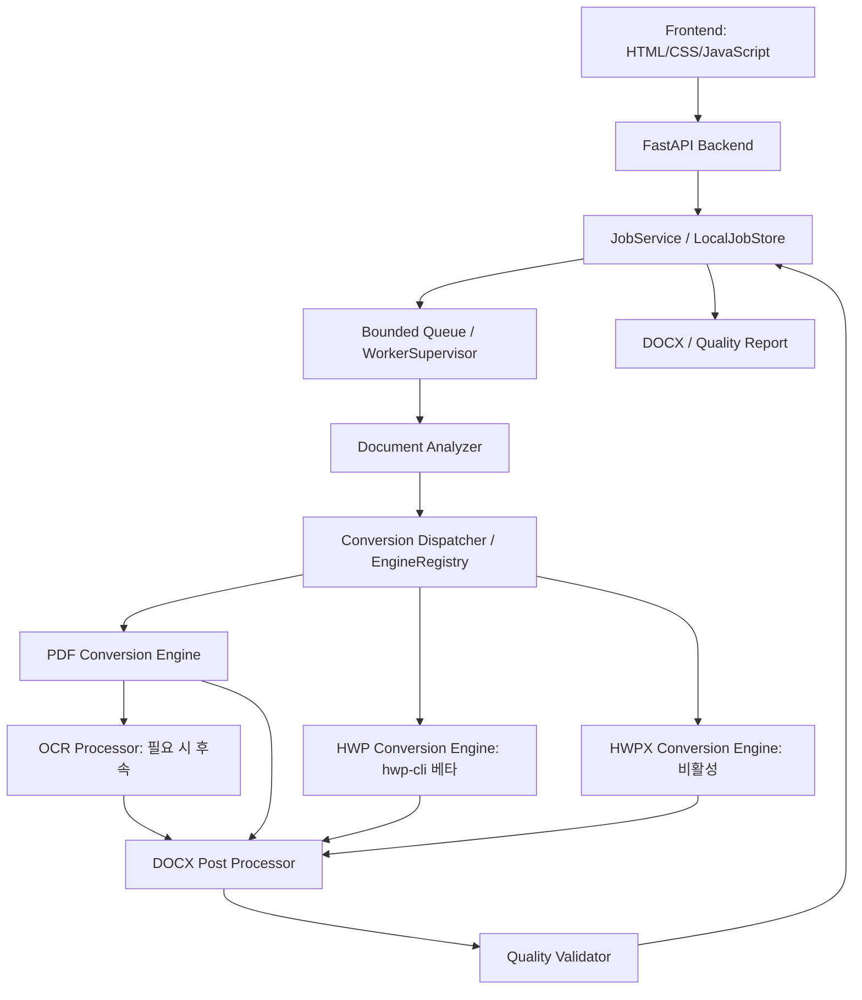

# 시스템 아키텍처

기준일: 2026-10-24. 아래는 1단계 아키텍처 기준 명세이며 계획·확장 구조를 포함한다. PDF 구현은 [STAGE2_REPORT](STAGE2_REPORT.md), 후속 HWP 5 베타의 실제 구조·제한은 [HWP_REPORT](HWP_REPORT.md)에 기록한다. 현재 실행 코드 구조·명령은 [README](../README.md)를 기준으로 한다. 제품 범위는 [PRD](PRD.md), 변환 정책은 [CONVERSION_SPEC](CONVERSION_SPEC.md)를 따른다.

## 1. 실행 구성

v0.4.0에서 사용자 선호 경로를 웹앱에 연결했다. 최신 구현은 [웹 경로 보고서](NATIVE_WEB_REPORT.md), 이전 CLI 단계는 [인수인계](HANDOFF.md)를 따른다. 한글 뷰어 PDF 출력 자체는 수동이다.

`POST /api/v1/native/jobs` → `JobService.create(native_embedded)` → 격리 worker → `HwpAnalyzer`의 원본 본문과 `DocumentAnalyzer`의 기준 PDF 대조 → `NativeEmbeddedEngine` → `Pdf2DocxEngine` → `DocxPostProcessor` → `embed_local_fonts` → `QualityValidator` 순서다. PDF 입력의 native 모드는 HWP 대조 단계만 생략한다. 기존 HWP 직접 초안 경로는 명시적으로 선택한 `balanced`에서만 사용한다.

`NativeReferences`는 별도 로컬 저장소 `runtime/native-references/<source SHA-256>/reference.pdf`와 `meta.json`을 관리한다. 등록 시 HWP/PDF 분석·본문 문자 포함률 ≥99%·무결성을 확인하고, 조회 시 PDF SHA-256을 확인한다. 전체 256 MiB/개별 30 MiB/24시간 TTL이며 만료는 조회와 시작·60초 정리에서 회수한다. 서버 중지 중 정리는 다음 실행으로 미뤄진다. 입력 HWP는 캐시에 보관하지 않는다. 첨부 PDF는 작업 input에만 복사하고 작업 종료 후 삭제한다. 캐시가 없으면 `NATIVE_REFERENCE_REQUIRED`로 중단하며 다른 경로로 대체하지 않는다.

API는 기존 작업 조회·취소·다운로드·보고서·1시간 결과 TTL을 공유한다. native multipart는 원본과 기준 PDF 두 개만 허용하며 각각 30 MiB, 요청 본문은 합산 상한 +64 KiB를 적용한다. native 글꼴 디렉터리는 서버 설정에서만 전달하고 API 임의 경로를 받지 않는다. 원본 HWP와 기준 PDF 입력 복사본 해시를 변환 전후 대조한다.



초기 서버는 FastAPI 한 프로세스·단일 API worker이고, 작업 감독자가 변환마다 별도 Python 자식 프로세스를 실행한다. 무거운 파싱·변환·검증을 HTTP 요청이나 `BackgroundTasks` 안에서 직접 실행하지 않는다. asyncio bounded queue(대기 5개)와 변환 동시 1개로 시작한다. DB·Redis·외부 서비스는 없다.

작업 메타데이터는 `LocalJobStore`의 JSON으로 원자적 교체한다. 서버 프로세스만 메타데이터를 갱신하며 자식은 제한된 이벤트 파이프로 단계·페이지 진행·결과를 보고한다. 자식 종료 상태와 결과 검증을 감독자가 확인한 뒤 성공을 확정한다. 상태 JSON의 동시 갱신은 서버 내 잠금으로 직렬화한다. 다중 서버 프로세스는 이 구조에서 지원하지 않는다.

## 2. 모듈과 클래스 책임

| 모듈 | 클래스 / 주요 메서드 | 책임 |
| --- | --- | --- |
| Frontend | `UploadController`, `JobPoller` | 접근 가능한 업로드·모드 선택·상태/오류/다운로드 UI |
| FastAPI Backend | `create_app`, `JobService.create/get/delete` | 입력 계약, 작업 생성, 상태·다운로드, 동일 출처 정적 자원 |
| Document Analyzer | `DocumentAnalyzer.analyze`, `FileTypeDetector.detect` | 파일 판별, PDF 페이지별 분석, 보호·손상·지원 요소 확인 |
| Conversion Dispatcher | `ConversionDispatcher.select`, `EngineRegistry.probe` | 형식·모드·환경별 후보 선택, 미지원·누락 의존성 구분 |
| PDF Conversion Engine | `Pdf2DocxEngine` | `pdf2docx` 호출·결과 어댑트; 후보, 미구현 |
| HWP Conversion Engine | `HwpCliEngine`, `HwpAnalyzer`, `HwpDocxPostProcessor` | 고정 native CLI + OLE/지원 요소 분석 + 표 후처리·결과 검증. `.tools`가 없으면 unavailable |
| HWPX Conversion Engine | 향후 `HwpxModelEngine` 또는 `OnlyOfficeHwpxEngine` | XML→공통 모델 또는 외부 엔진 경로; 현재 구현 없음 |
| OCR Processor | `OCRProcessor` Protocol, 향후 `TesseractOCRProcessor` | 페이지 단위 텍스트·bbox·confidence 제공; 기본 비활성 |
| DOCX Post Processor | `DocxPostProcessor.process`, `FontResolver.resolve` | section·한글 글꼴·스타일·관계 보정, 손실 경고 |
| Quality Validator | `QualityValidator.validate`, `DocxInspector`, `RenderComparator` | 패키지·편집 가능성·구조 검증, 선택적 렌더 비교 |
| 작업/파일 관리 | `WorkerSupervisor`, `LocalJobStore`, `JobWorkspace`, `CleanupService` | 프로세스·타임아웃·원자 저장·삭제·만료·다운로드 lease |

`python-docx`는 렌더러가 아니다. 페이지 수나 실제 배치 비교는 `RenderComparator`가 별도 렌더러를 확보한 경우에만 측정한다.

## 3. 예정 폴더 구조

아래 트리는 최종 확장을 포함한 설계 목표다. API는 `app/main.py`, 작업 큐·저장·정리는 `app/services/job_service.py`에 통합했다. 후속 HWP 코드는 `engines/hwp/`, `services/hwp_analyzer.py`, `postprocess/hwp.py`에 추가했다. HWPX/OCR·렌더러·Dockerfile은 만들지 않았다. 실제 구조는 README와 HWP 보고서를 참고한다.

```text
.
├── AGENTS.md
├── README.md
├── .gitignore
├── .venv/
├── requirements-probe.txt
├── pyproject.toml                  # 2단계: 메타데이터·pytest 설정
├── requirements.lock              # 2단계: 검증된 전이 의존성까지 고정
├── app/
│   ├── main.py
│   ├── config.py
│   ├── api/
│   │   ├── routes_health.py
│   │   ├── routes_capabilities.py
│   │   ├── routes_jobs.py
│   │   ├── schemas.py
│   │   └── errors.py
│   ├── frontend/
│   │   ├── index.html
│   │   └── static/{app.js,styles.css}
│   ├── domain/
│   │   ├── models.py              # DocumentAnalysis, DocumentModel
│   │   ├── jobs.py                # Job, JobState, ProgressEvent
│   │   └── errors.py              # DomainError, ErrorCode
│   ├── services/
│   │   ├── analyzer.py
│   │   ├── dispatcher.py
│   │   └── job_service.py
│   ├── engines/
│   │   ├── base.py                # ConversionEngine, EngineCapability
│   │   ├── registry.py
│   │   ├── pdf/pdf2docx_engine.py
│   │   ├── hwp/                  # 구현 확정 후 생성
│   │   └── hwpx/                 # 구현 확정 후 생성
│   ├── ocr/{base.py,tesseract.py} # tesseract.py는 OCR 단계
│   ├── postprocess/{docx.py,fonts.py,ooxml.py}
│   ├── quality/{validator.py,docx_inspector.py,renderer.py,metrics.py}
│   └── infrastructure/{worker.py,workspace.py,job_store.py,cleanup.py}
├── scripts/probe_environment.py
├── tests/
│   ├── unit/
│   ├── contract/
│   ├── integration/
│   ├── e2e/
│   ├── quality/
│   └── fixtures/{generated,licensed,expected}/
├── docs/{PRD.md,ARCHITECTURE.md,CONVERSION_SPEC.md,TEST_PLAN.md}
├── docs/research/environment.json
├── runtime/jobs/                  # 비공개, git 제외; 기본 작업 루트
└── Dockerfile                     # Linux 검증 단계
```

`hwp/`, `hwpx/` 빈 구현을 성공 가능한 것처럼 만들지 않는다. 라이선스가 확인된 샘플만 `licensed/`에 두고 사용자의 업무 문서를 git에 추가하지 않는다.

## 4. 엔진 공통 계약

다음은 타입 명세다. 실행 코드나 가상 변환 구현이 아니다.

```python
class ConversionEngine(Protocol):
    def probe(self) -> EngineCapability: ...
    def can_convert(self, analysis: DocumentAnalysis,
                    options: ConversionOptions) -> SupportDecision: ...
    def convert(self, source: Path, analysis: DocumentAnalysis,
                options: ConversionOptions, workspace: JobWorkspace,
                emit: Callable[[ProgressEvent], None]) -> EngineResult: ...
```

| 타입 | 필수 필드 / 규약 |
| --- | --- |
| `EngineCapability` | `engine_id`, `version`, `availability`(available/unavailable/experimental), `formats`, `modes`, `features`, `reason_code`; 설치되어도 품질 미검증이면 experimental |
| `SupportDecision` | `supported`, `reason_code`, `warnings`; 내용 분석 뒤 엔진별 허용 범위를 판단 |
| `DocumentAnalysis` | `format`, `variant`, `pages`(불명은 null), `encrypted`, `ocr_required_pages`, `fonts`, `unsupported_features`, `warnings`; PDF 페이지별 text/image/unknown 분류 |
| `ConversionOptions` | `mode`, `ocr`(off/auto), `ocr_languages`; MVP는 balanced/off만 가능 |
| `EngineResult` | `docx_path`(작업 내부 임시 파일), `engine_id/version`, `warnings`, `source_map`(없으면 null), `document_model`(없으면 null) |
| `ProgressEvent` | `stage`, `completed_pages`, `total_pages`, `fraction`(측정 불가 null); 이벤트에 본문·경로를 싣지 않음 |
| `QualityReport` | `schema_version`, `validation_status`, `metrics`, `warnings`, `renderer`, `manual_review`; 각 지표 `measured/not_measured/not_applicable` 구분 |

`convert`는 읽기 전용 업로드 복사본을 받아 작업 내부 DOCX 임시 파일을 생성한다. 실패는 `DomainError(code, message_ko, details)`로 전달하고 부분 결과를 성공으로 내보내지 않는다. 강제 종료는 감독자가 담당한다. 기본 fallback은 **없음**이다. 검증된 로컬 대안이 생겨도 선택 엔진·손실·재시도 이력을 보고서에 남긴다.

외부 엔진이 DOCX를 직접 생성하는 경로는 공통 모델 변환을 강요하지 않는다. 검사·후처리·보고서를 동일 계약으로 묶는다. 자체 HWPX 경로만 우선 다음 `DocumentModel`을 사용한다.

```text
DocumentModel
  sections: SectionModel(page_size_pt, margins_pt, orientation, header, footer)
  blocks: ParagraphModel | TableModel | ImageModel | PageBreakModel
  ParagraphModel: style_id, heading_level?, alignment, indents_pt, spacing_pt, runs
  RunModel: text, font_family, east_asia_font, size_pt, bold, italic, color
  TableModel: rows, column_widths_pt, cells(row, col, row_span, col_span, blocks)
  ImageModel: asset_id, bbox_pt?, anchor_kind, original_dimensions
  assets: image bytes + hash + MIME
  provenance: source page/section/element, confidence, inferred_fields
```

좌표는 회전·cropbox를 정규화한 페이지 좌상단 기준 pt(1/72 inch)로 통일한다. DOCX 길이는 twip=20/pt, EMU=12,700/pt로 변환한다. HWP/HWPX 치수는 형식 명세에 따라 단위를 해석하고 원래 단위·출처를 유지한다. 추정 여백·제목·읽기 순서를 확정 원본 속성처럼 표시하지 않는다.

## 5. API v1 계약

### 엔드포인트

| Method / Path | 요청 | 응답 |
| --- | --- | --- |
| `GET /api/v1/health` | 없음 | 200: `status`, `api_version`; 엔진 미설치여도 API가 살아 있으면 ok |
| `GET /api/v1/capabilities` | 없음 | 200: `formats`, 형식별 `availability`, `engine_id`, `modes`, `ocr`, `reason_code`, `limits` |
| `POST /api/v1/jobs` | multipart `file` 1개, `mode=balanced`, `ocr=off` | 202 + `Location`: 생성된 작업; 오류는 아래 규약 |
| `GET /api/v1/jobs/{job_id}` | UUID | 200: 현재 상태, 404: 없음, 410: 만료·삭제 tombstone |
| `GET /api/v1/jobs/{job_id}/download` | UUID | 200: 검증된 DOCX 스트림; 409: 준비 안 됨/실패, 410: 만료 |
| `GET /api/v1/jobs/{job_id}/quality` | UUID | 200: 생성된 품질 보고서; 409: 미생성, 410: 만료 |
| `DELETE /api/v1/jobs/{job_id}` | UUID | 202: 취소·삭제 요청 접수; 이미 삭제·만료는 204, 모르는 ID는 404 |

파일 업로드는 생성과 함께 한 번만 한다. 원본 미리보기 API는 후속이며 현재 원본을 웹 경로에 노출하지 않는다. GET 요청은 부작용 없이 상태만 읽는다. 상태 polling은 활성 화면에서 1초 간격, 비활성 탭에서는 완화하며 terminal 상태에서 중단한다.

```json
{
  "job_id": "c56a4180-65aa-42ec-a945-5fd21dec0538",
  "state": "queued",
  "stage": "waiting",
  "format": "pdf",
  "mode": "balanced",
  "progress": {"fraction": null, "completed_pages": 0, "total_pages": null},
  "engine": null,
  "warnings": [],
  "error": null,
  "links": {"self": "/api/v1/jobs/c56a4180-65aa-42ec-a945-5fd21dec0538", "download": null, "quality": null},
  "created_at": "2026-10-24T04:00:00Z",
  "expires_at": null
}
```

시각은 UTC RFC3339로 전송하고 UI에서 현지 시간으로 표시한다. format·page 수·engine은 분석 전 null일 수 있다. download 링크는 성공 상태에서만 채운다. `succeeded`는 구조 검사 합격을 뜻하며 시각·Word 검토까지 합격했다는 의미가 아니다. 상세 품질 검증 상태는 보고서에 따로 표시한다.

### 오류 규약

```json
{
  "error": {
    "code": "OCR_REQUIRED",
    "message": "스캔 또는 텍스트를 읽을 수 없는 페이지가 있어 OCR이 필요합니다.",
    "retryable": false,
    "details": {"pages": [2, 5]},
    "suggestion": "OCR 지원을 활성화한 후 다시 변환하세요."
  },
  "request_id": "f4918d5b-44cc-43ce-abf6-d822b6e5b682"
}
```

| HTTP(접수 단계) | 오류 코드 | 의미 |
| --- | --- | --- |
| 400 | `INVALID_DOCUMENT`, `FORMAT_MISMATCH`, `ARCHIVE_LIMIT_EXCEEDED` | 손상·위장·과도한 압축 입력 |
| 413 | `FILE_TOO_LARGE` | 스트리밍 중 업로드 상한 초과 |
| 415 | `UNSUPPORTED_FORMAT`, `UNSUPPORTED_VARIANT` | 다른 형식·HWP 구형 등 미지원 변종 |
| 422 | `INVALID_OPTIONS`, `PASSWORD_PROTECTED`, `RESTRICTED_DOCUMENT`, `OCR_REQUIRED`, `UNSUPPORTED_FEATURE` | 필드/모드 오류 또는 문서 제약 |
| 429 | `QUEUE_FULL` | 대기열 초과, Retry-After 5초 |
| 503 | `ENGINE_UNAVAILABLE`, `DEPENDENCY_MISSING` | 형식은 알려졌지만 활성 엔진 없음 |
| 500 | `INTERNAL_ERROR` | 예기치 못한 서버 오류; 내부 trace는 사용자 응답에서 제외 |

무거운 분석은 접수 후 자식에서 실행하므로 `POST 202` 뒤에도 위 문서 오류로 실패할 수 있다. 이때 HTTP `GET`은 200이며 `state=failed`, `error`에 같은 envelope의 error 객체를 담는다. 작업 실행 오류는 `CONVERSION_TIMEOUT`, `RESOURCE_LIMIT`, `ENGINE_FAILED`, `VALIDATION_FAILED`, `INTERRUPTED`, `CLEANUP_FAILED`로 구분한다. 첫 MVP의 HWP/HWPX는 판별 후 `ENGINE_UNAVAILABLE`를 반환한다. 파일 유효성 확인 실패와 엔진 비활성을 혼동하지 않는다.

### 다운로드·작업 접근

DOCX MIME은 `application/vnd.openxmlformats-officedocument.wordprocessingml.document`, 파일명은 고정 `converted.docx`로 `Content-Disposition: attachment` 처리한다. DOCX와 품질 응답에 `Cache-Control: no-store`, 다운로드에 `X-Content-Type-Options: nosniff`를 적용한다. 임의 경로를 API 매개변수로 받지 않는다.

초기 localhost 단일 사용자 환경에서 UUID 작업 ID를 사용한다. 동일 출처 요청만 허용하고 CORS wildcard를 사용하지 않는다. Host/Origin 검사와 로컬 세션 CSRF 토큰으로 다른 사이트의 localhost 작업 생성·삭제를 제한한다. 이 구성을 멀티테넌트 인증으로 간주하지 않으며 외부 공개 전 소유권·인증 체계를 별도 구현한다.

## 6. 상태 전이·취소·복구

```text
queued → analyzing → converting → postprocessing → validating → succeeded
각 비종료 상태 → failed
queued/analyzing/converting/postprocessing/validating → cancelling → cancelled
succeeded/failed/cancelled → expired
```

`state`는 위 값 중 하나, `stage`는 현재 하위 작업 설명이다. 변환이 세부 진행률을 제공하지 않을 때 `fraction=null`을 유지한다. 전체 진행률은 단계 가중치로 꾸며내지 않는다.

삭제 요청은 우선 접근을 막고 자식 프로세스 그룹에 종료 요청→5초 후 강제 종료→자식 종료 확인→작업 파일 삭제 순서다. 삭제 실패 시 접근 차단을 유지하고 `CLEANUP_FAILED`를 기록하며 60초마다 재시도한다. `cancelled`는 변환 종료를 뜻하고 실제 삭제 완료는 `deleted_at`으로 별도 기록한다. 성공 작업 삭제도 진행 중 다운로드 종료를 최대 60초 기다린 뒤 스트림을 닫고 정리한다.

서버 재시작 시 미완료 작업은 자동 재실행하지 않고 `failed/INTERRUPTED`로 처리한다. 성공 결과도 파일·해시가 유효한지 재검사한다. 자식은 부모 생존 확인/heartbeat로 부모가 사라지면 종료하고, supervisor는 생성한 프로세스 그룹만 관리한다. 재시작 복구 시 실행 흔적이 남은 작업은 정리를 보류하고 소유 자식 종료를 확인한다. OS PID만으로 무관한 프로세스를 종료하지 않는다.

## 7. 저장·수명·자원 정책

```text
runtime/jobs/<uuid>/
  input/source.<detected-format>    # 업로드 복사본, 생성 이후 읽기 전용
  work/                            # 중간 모델·추출 이미지·임시 DOCX
  output/result.docx               # 검증 후 원자 rename
  output/quality.json
  meta.json                        # 내용 없는 메타데이터
```

| 대상 | 수명 / 삭제 정책 |
| --- | --- |
| 업로드 도중 임시 파일 | 스트리밍 실패·크기 초과 시 즉시 삭제; 접수 전 버려진 폴더는 시작 시·매 60초 정리 |
| 성공 작업의 입력 복사본·중간 파일 | 품질 검증 종료 후 즉시 삭제; 추후 비교 기능은 별도 정책으로 명시적 보존 |
| 실패 작업의 입력 복사본·부분 결과 | 자식 종료 확인 후 즉시 삭제; 오류 메타데이터만 유지 |
| DOCX·품질 보고서·작업 메타데이터 | terminal 시각부터 1시간; GET·다운로드로 만료 연장 없음 |
| 삭제/만료 tombstone | 내용·파일명·경로 없이 작업 ID·사유·시각만 24시간 유지 후 제거; 이 기간은 410, 이후 404 |
| 표준 로그 | 내용 없는 운영 로그만 로컬 최대 7일 순환; DEBUG에 원문·trace 데이터 삽입 금지 |

정리 루프는 60초마다 및 서버 시작 때 동작한다. `expires_at` 이후는 파일이 물리적으로 남아 있어도 접근을 거부한다. 다운로드 시작 시 lease를 잡고 만료 시 새 lease를 금지한다. 실행 작업은 TTL 삭제 대상이 아니며 180초 deadline과 프로세스 종료 정책으로 회수한다. 로컬 서버가 꺼져 있으면 정리가 실행되지 않으므로 다음 실행 시 정리된다는 한계를 UI/README 실행 안내에 명시한다. 일반 파일 삭제이며 저장장치의 보안 소거를 보장하지 않는다. 사용자 원본 경로는 어떤 정리 대상에도 포함하지 않는다.

기본 상한은 업로드 30 MiB, PDF 100쪽, ZIP 항목 2,000개·항목당 20 MiB·총 해제 200 MiB·압축비 100:1, XML 한 파일 10 MiB·최대 깊이 128이다. 입력 제한은 설정 가능하되 검증 결과 없이 상향하지 않는다. ZIP은 디렉터리 전체 해제 대신 허용 항목만 제한 읽기하고 경로 탈출·절대 경로·중복 이름·심볼릭 링크·암호화 항목을 거부한다. XML은 DTD·엔티티·외부 리소스를 금지하고 방어 파서를 사용한다.

작업 메모리는 1 GiB 목표 상한, 작업 루트 전체 1 GiB 상한으로 시작한다. 상한 초과는 새 접수 거부 또는 해당 작업 실패로 처리하고 미만료 다른 작업을 임의로 삭제하지 않는다. macOS의 프로세스 메모리 제한은 Linux cgroup과 동등하지 않으므로 감독자 RSS 감시·deadline을 우선 검증하고 한계를 기록한다. Docker 단계에서 비root 사용자·CPU/메모리 제한·read-only rootfs·허용 작업 볼륨·네트워크 차단을 적용한다. arm64와 amd64는 별도 검증 대상이다.

## 8. 단계 2 구현 순서

1. probe 의존성을 실제 설치하고 smoke·pytest 실행 환경 확보, 전이 의존성 lock 생성.
2. `config`, 도메인 타입, 오류·파일 판별·`JobWorkspace`·저장소·복구/정리 구현.
3. `ConversionEngine`·PDF 어댑터·분석기·후처리·기본 validator 구현.
4. supervisor·단일 작업 큐·API·capabilities 구현; HWP/HWPX·OCR은 명시적 비활성.
5. 한국어 업로드·상태·오류·다운로드 UI, API·UI 통합·실문서 검증.
6. 결과를 TEST_PLAN과 README에 갱신하고 실제 지원되는 입력 특징을 공개.
